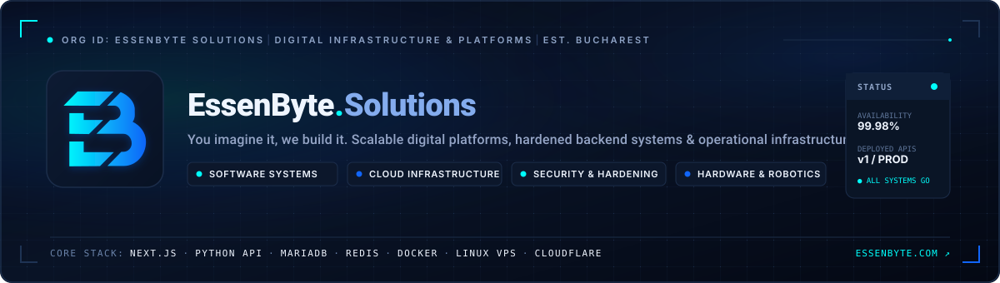
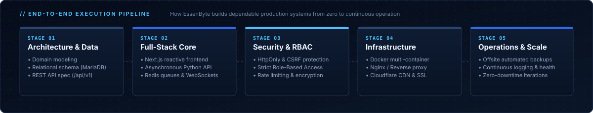
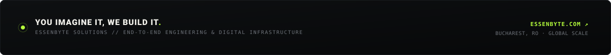

<!--
  E S S E N B Y T E   S O L U T I O N S
  GitHub Organization Profile. Engineered for reality. Built to scale.
  Assets located in ./assets/.
-->

<div align="center">
  

  <br />

  <a href="https://essenbyte.com"></a>
  <a href="https://scoreengine.online"></a>
  <a href="mailto:office@essenbyte.com"></a>

  <br /><br />

  <b>Digital Systems Architecture &nbsp;·&nbsp; Cloud Infrastructure &nbsp;·&nbsp; Security Hardening &nbsp;·&nbsp; Real-Time Operations</b>

  <br /><br />

  <a href="#about-essenbyte">About</a> &nbsp; • &nbsp;
  <a href="#what-we-deliver">Capabilities</a> &nbsp; • &nbsp;
  <a href="#engineering-pipeline">Pipeline</a> &nbsp; • &nbsp;
  <a href="#ecosystem--platforms">Ecosystem</a> &nbsp; • &nbsp;
  <a href="#production-stack">Stack</a> &nbsp; • &nbsp;
  <a href="#connect-with-us">Contact</a>

</div>

<br />

## About EssenByte

**EssenByte Solutions** is a technology and systems engineering brand focused on building, deploying, and operating **resilient digital platforms and scalable infrastructure**.

We don't do superficial templates or fragile demos. We bridge the gap between high-level architectural design and the gritty reality of production: **relational database schemas, asynchronous API services, strict role-based access control, Linux host hardening, containerized deployments, and high-availability operations.**

> **“You imagine it, we build it.”**  
> Scalable software, hardened infrastructure, and zero tolerance for “it works on my machine.”

<br />

## What we deliver

<table>
  <tr>
    <td width="33%" valign="top">
      <h3><code>01</code> — Software Systems</h3>
      <p>Custom <strong>reactive web applications, platforms, and versioned APIs</strong>. Architected with Next.js, asynchronous Python, and real-time WebSockets. Clean domain modeling, multi-tenant isolation, and intuitive UX.</p>
    </td>
    <td width="33%" valign="top">
      <h3><code>02</code> — Infrastructure & Cloud</h3>
      <p>Dedicated <strong>Linux server orchestration, Docker container stacks, and high-performance reverse proxies</strong>. Configured with automated off-site backups, resource monitoring, and Cloudflare edge acceleration.</p>
    </td>
    <td width="33%" valign="top">
      <h3><code>03</code> — Security & Operations</h3>
      <p>Production hardening from day zero: <strong>HttpOnly authentication, CSRF guards, RBAC, rate-limiting, and data encryption</strong>. Preventive maintenance and fast incident mitigation to keep platforms online.</p>
    </td>
  </tr>
</table>

<br />

## Engineering Pipeline

<p align="center">
  
</p>

<br />

## Ecosystem & Platforms

<!-- Production platforms and live projects engineered or operated by EssenByte Solutions -->
<table>
  <tr>
    <td width="50%" valign="top">
      <h3>⚡ <a href="https://scoreengine.online">ScoreEngine</a></h3>
      <p><strong>Next-generation competition &amp; tournament management ecosystem.</strong></p>
      <p>Engineered to handle high-concurrency event operations: team registrations, participant consent workflows, refereeing scoring grids, and low-latency real-time state synchronization.</p>
      <p><code>Real-time scoring</code> <code>Python / Next.js</code> <code>WebSockets</code> <code>RBAC</code></p>
      <p><strong><a href="https://scoreengine.online">Explore ScoreEngine →</a></strong></p>
    </td>
    <td width="50%" valign="top">
      <h3>🤖 <a href="https://challenge.relativity.ro">Relativity Robotics Challenge</a></h3>
      <p><strong>Official Technical Infrastructure Partner.</strong></p>
      <p>EssenByte powers the mission-critical technical infrastructure behind RRC: participant qualification portals, match coordination, jury verification systems, and event reliability.</p>
      <p><code>Event infrastructure</code> <code>Live operations</code> <code>Robotics ecosystem</code></p>
      <p><strong><a href="https://challenge.relativity.ro">Explore Relativity Challenge →</a></strong></p>
    </td>
  </tr>
  <tr>
    <td width="50%" valign="top">
      <h3>⬡ <a href="https://voxelworks.ro">VoxelWorks</a></h3>
      <p><strong>Where e-commerce meets automated digital manufacturing.</strong></p>
      <p>Custom-built operational software connecting consumer orders directly to physical production: 4mm poplar plywood laser processing, custom A4 frames, and 3D prototyping workflows.</p>
      <p><code>Digital manufacturing</code> <code>E-Commerce</code> <code>Automated workflows</code></p>
      <p><strong><a href="https://voxelworks.ro">Explore VoxelWorks →</a></strong></p>
    </td>
    <td width="50%" valign="top">
      <h3>◈ <a href="https://essenbyte.com">EssenByte Core Systems</a></h3>
      <p><strong>Unified corporate &amp; API digital infrastructure.</strong></p>
      <p>Centralized authentication, role management, unified API gateway (<code>api.essenbyte.com/v1</code>), secure asset storage, and hosting virtualization for internal and client services.</p>
      <p><code>Docker</code> <code>Python API</code> <code>MariaDB + Redis</code> <code>Cloudflare</code></p>
      <p><strong><a href="https://essenbyte.com">Visit EssenByte.com →</a></strong></p>
    </td>
  </tr>
</table>

<br />

## Production Stack

<!-- Core technologies utilized across EssenByte Solutions production infrastructure -->

**Application & API Engineering**

<p>
  
  
  
  
  
  
</p>

**Data Plane & State Management**

<p>
  
  
  
  
</p>

**Infrastructure, Hardening & Delivery**

<p>
  
  
  
  
  
</p>

<br />

## The EssenByte Standard

```text
+-------------------------------------------------------------------------+
|  01.  Clean Architecture    Modular services, versioned APIs & clean DB |
|  02.  Defensive Security    Zero trust, RBAC, HttpOnly cookies, CSRF    |
|  03.  Deterministic Infra   Isolated Docker containers, automated tasks |
|  04.  Real-World Execution  Built to stay up, tested under real load    |
+-------------------------------------------------------------------------+
```

<br />

## Connect with Us

Have an ambitious digital platform, complex operational workflow, or high-reliability infrastructure need? Let's build it right.

<div align="center">
  <a href="https://essenbyte.com"></a>
  <a href="mailto:office@essenbyte.com"></a>
  <a href="https://www.linkedin.com/in/lucian-mihai-lup%C8%99%C4%83-696442277/"></a>

  <br /><br />

  
</div>
